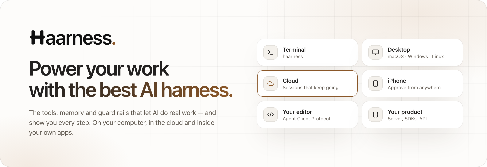

<p align="center">
  <a href="https://haarness.ai">
    <picture>
      <source media="(prefers-color-scheme: dark)" srcset="assets/banner-dark.png">
      
    </picture>
  </a>
</p>

<p align="center">
  <a href="https://haarness.ai"><b>haarness.ai</b></a>&nbsp;&nbsp;·&nbsp;&nbsp;<a href="https://haarness.ai/docs"><b>Docs</b></a>&nbsp;&nbsp;·&nbsp;&nbsp;<a href="https://haarness.ai/pricing"><b>Pricing</b></a>&nbsp;&nbsp;·&nbsp;&nbsp;<a href="mailto:admin@haarness.ai"><b>admin@haarness.ai</b></a>
</p>

**Haarness is the harness around the model** — the tools, memory and guard rails that let AI do real
work and show you every step, on your computer, in the cloud and inside your own apps. Describe the
outcome in your own words; Haarness plans the steps, uses the right tools and checks its own work.

### One assistant. Every screen you use.

| Where | What you get |
| --- | --- |
| **Terminal** | A quiet, keyboard-first terminal UI and a CLI for scripts and CI |
| **Desktop** | macOS, Windows and Linux, with diff review, terminals and a built-in browser |
| **Cloud** | Sessions that keep going when you close the lid, schedules, one account for every model |
| **Your phone** | Follow every chat and approve from the Lock Screen or the notification shade, on iPhone and Android |
| **Your editor** | Through the Agent Client Protocol |
| **Your product** | A versioned server API with TypeScript and Python SDKs |

### Install on macOS, Linux and Windows

One command installs the terminal app and Desktop:

```sh
curl -fsSL https://haarness.ai/install.sh | sh                      # macOS and Linux
curl -fsSL https://haarness.ai/install.sh | sh -s -- --no-desktop   # without Desktop
```

```powershell
irm https://haarness.ai/install.ps1 | iex                                # Windows, in PowerShell
$env:HAARNESS_NO_DESKTOP='1'; irm https://haarness.ai/install.ps1 | iex  # without Desktop
```

Or download it from [haarness.ai/download](https://haarness.ai/download): `.dmg` for macOS, `.AppImage`
and `.deb` for Linux, `.exe` for Windows, each for both Intel/AMD and ARM.

### Capable, and on your terms

- **Choose what it may do.** Approve sensitive steps as they come, or have it ask before every change.
  Your rules are plain text you can read.
- **See every step.** Every file it read, every command it ran and every change it made, in order, with
  what it cost.
- **Any model.** Sign in with your ChatGPT or GitHub Copilot plan, bring your own keys, run models on
  your own machine — or use one Haarness account for all of them.

### Open at the core. Hosted when you want it.

| Project | What it is | License |
| --- | --- | --- |
| **haarness** | The agent, terminal app, Desktop, server and SDKs — free on your computer | Apache 2.0 |
| **haarness-router** | A stateless, OpenAI-compatible router for every model provider | MIT |
| **haarness-cloud** | Haarness Cloud, the hosted service built on the same runtime | Hosted |
| **haarness-ios** | Haarness for iPhone and iPad, coming soon | — |
| **haarness-android** | Haarness for Android phones and tablets, coming soon | — |

The repositories open soon. Until then, write to us at **admin@haarness.ai**.

<sub>The Haarness name and logo are trademarks of the Haarness project.</sub>
